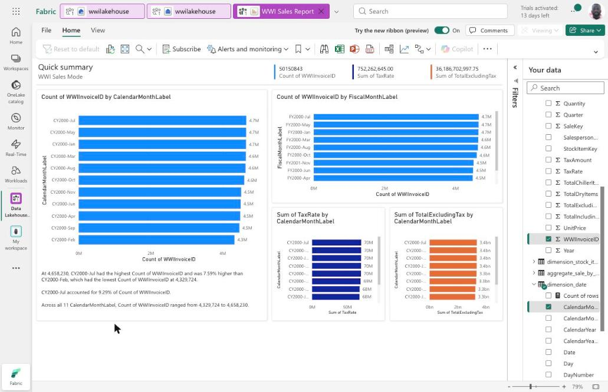
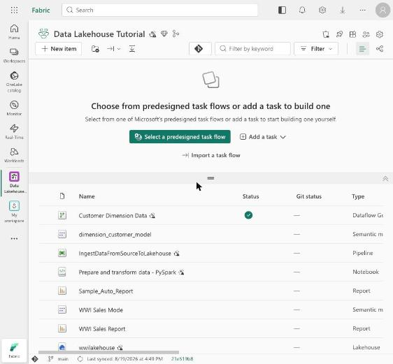
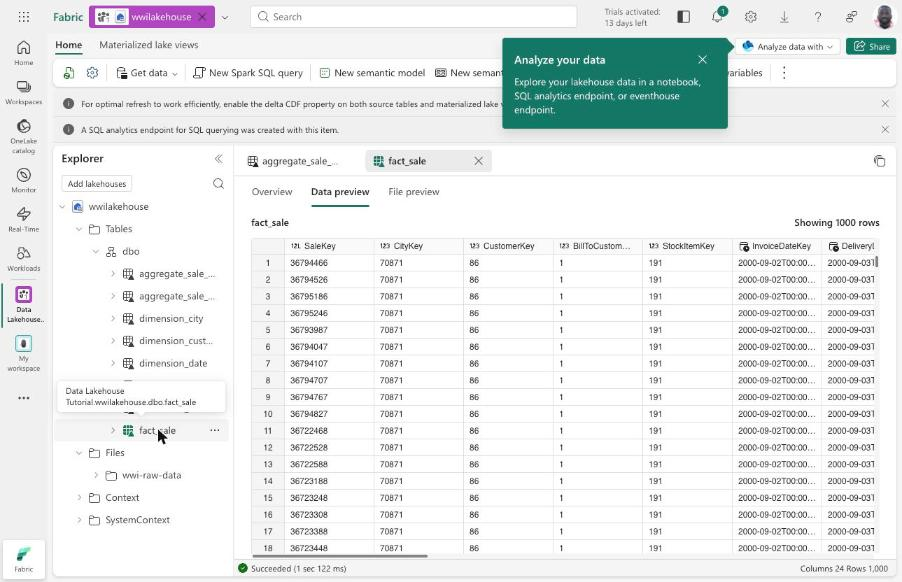
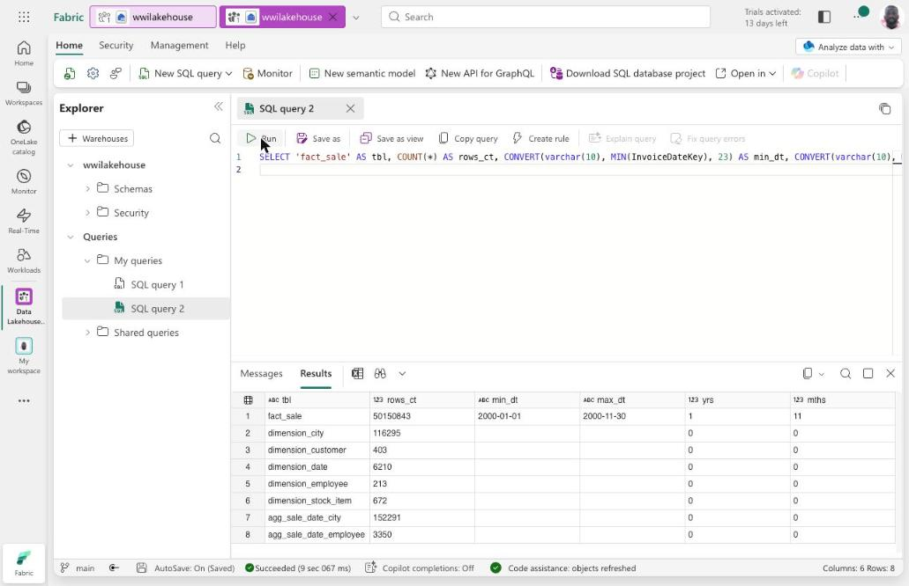

# Wide World Importers lakehouse — Microsoft Fabric

An end-to-end lakehouse built in Microsoft Fabric on the fictional Wide World
Importers (WWI) retail dataset. Raw Parquet lands in OneLake, PySpark turns it
into Delta tables and business aggregates, and Power BI reads them over Direct
Lake — **50.1 million sales rows**, no import, no refresh cycle.



This repository *is* the Fabric workspace **Data Lakehouse Project** — every
folder is a Fabric item, kept in sync through workspace Git integration rather
than committed by hand.

## Architecture

```
Azure Blob Storage                 Fabric workspace: Data Lakehouse
sampledata/
  WideWorldImportersDW/parquet
          │
          │  IngestDataFromSourceToLakehouse (Data pipeline, binary Copy)
          ▼
  wwilakehouse / Files / wwi-raw-data        ← raw layer
          │
          │  Prepare and transform data - PySpark (Notebook)
          ▼
  wwilakehouse / Tables / dbo / …            ← Delta tables + two aggregates
          │
          │  Direct Lake on OneLake
          ▼
  WWI Sales Mode (semantic model) → WWI Sales Report
```

A Dataflow Gen2, **Customer Dimension Data**, loads `dimension_customer` from a
CSV in the `microsoft/fabric-samples` repo — the low-code counterpart to the
notebook's own load of that table. See [Known issues](#known-issues).

## What's in the workspace



| Folder | Fabric item | What it does |
| --- | --- | --- |
| `wwilakehouse.Lakehouse` | Lakehouse | Raw files and Delta tables. Schemas enabled, default schema `dbo`. |
| `IngestDataFromSourceToLakehouse.DataPipeline` | Data pipeline | Binary Copy from the public WWI blob container into `Files/wwi-raw-data`. |
| `Prepare and transform data - PySpark.Notebook` | Notebook | Builds the Delta tables and the two aggregates. Two paths: schema-enabled (`Tables/dbo/…`) and non-schema (`wwilakehouse.…`). |
| `Customer Dimension Data.Dataflow` | Dataflow Gen2 | Loads `dimension_customer` from CSV via Power Query, replacing the table each run. |
| `WWI Sales Mode.SemanticModel` | Semantic model | Direct Lake model over the lakehouse, with the star-schema relationships. |
| `WWI Sales Report&#32;.Report` | Report | Sales by month, city and salesperson. |
| `dimension_customer_model.SemanticModel`, `Sample_Auto_Report.Report` | Semantic model, Report | Auto-generated alongside the Dataflow; not part of the main flow. |

## The data

Source: the WWI sample in Parquet, one folder per table, in the public
`sampledata` blob container. The fact table carries 11 months of history
(January–November 2000). The tutorial's three further months of incremental data
are not loaded yet — that's the next step below.

`fact_sale` is written as Delta partitioned by `Year` and `Quarter`, with `Year`,
`Quarter` and `Month` derived from `InvoiceDateKey`. V-Order and Optimize Write
are enabled before the write.



## Verifying the build

One query against the SQL analytics endpoint covers every table at once:

```sql
SELECT 'fact_sale' AS tbl, COUNT(*) AS rows_ct,
       CONVERT(varchar(10), MIN(InvoiceDateKey), 23) AS min_dt,
       CONVERT(varchar(10), MAX(InvoiceDateKey), 23) AS max_dt
FROM dbo.fact_sale
UNION ALL SELECT 'dimension_city',  COUNT(*), '', '' FROM dbo.dimension_city
UNION ALL SELECT 'dimension_date',  COUNT(*), '', '' FROM dbo.dimension_date
-- …one line per remaining table
```



Verified 19 Nov 2026:

| Table | Rows |
| --- | ---: |
| `fact_sale` | 50,150,843 |
| `dimension_city` | 116,295 |
| `dimension_date` | 6,210 |
| `dimension_stock_item` | 672 |
| `dimension_customer` | 403 |
| `dimension_employee` | 213 |
| `aggregate_sale_by_date_city` | 152,291 |
| `aggregate_sale_by_date_employee` | 3,350 |

`fact_sale` spans 2000-01-01 to 2000-11-30 across 11 months, and the report's
invoice count matches the table row for row — so the model really is reading the
lakehouse, not a stale copy.

## Rebuilding it

1. Create a Fabric workspace on a trial or F-SKU capacity and connect it to this
   repository (Workspace settings → Git integration), or create the items by hand.
2. Create a lakehouse named `wwilakehouse` with schemas enabled.
3. Run **IngestDataFromSourceToLakehouse**. It lands the raw Parquet in
   `Files/wwi-raw-data`; expect several minutes for the full fact table.
4. Run **Prepare and transform data - PySpark**, Path 1 (`Tables/dbo/…`), in cell
   order: session config → `fact_sale` → dimensions → load sources → the two
   aggregates. Use Path 2 only if your lakehouse has no schemas.
5. Refresh the SQL analytics endpoint, then open the semantic model and report.

Check as you go: `Files/wwi-raw-data` holds one folder per table, `Tables/dbo`
lists eight tables, the row counts above match, and the report's invoice count
equals the `fact_sale` row count.

## Known issues

- **`dimension_customer` has two writers.** The notebook builds it from Parquet
  and the Dataflow replaces it from CSV. Whichever runs last wins — pick one owner
  before orchestrating both in a single pipeline.
- **Notebook Path 2, aggregate cells.** They write with
  `.save("Tables/aggregate_…")` while the rest of Path 2 and its markdown use
  `saveAsTable("wwilakehouse.…")`. Harmless on the schema-enabled path, but
  inconsistent for anyone following Path 2.
- **Relationships.** Only `fact_sale → dimension_city` sets
  `relyOnReferentialIntegrity`; the other four do not. Worth making consistent.
- **Item names.** `WWI Sales Mode` is missing a letter, and `WWI Sales Report `
  has a trailing space — hence the `&#32;` in that folder name.

## Next steps

- Orchestrate the notebook from the pipeline, with a step to refresh the SQL
  analytics endpoint after the load.
- Load the three months of incremental data and merge it with a Delta `MERGE`, so
  October and November update in place and December is appended.
- Rebuild the same lakehouse fully low-code with Dataflows Gen2 across bronze,
  silver and gold, and compare the two.

---

*Screenshots captured from the live Fabric workspace, 19 Nov 2026.*
